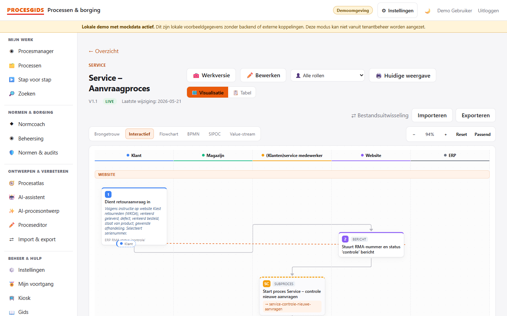
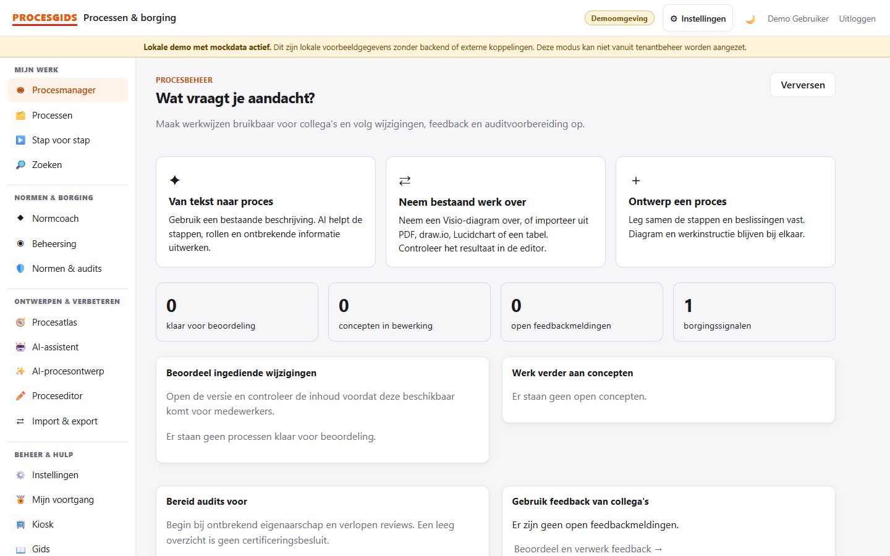
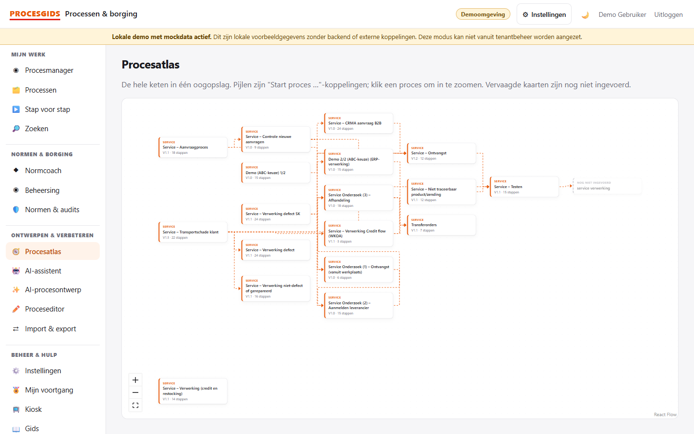
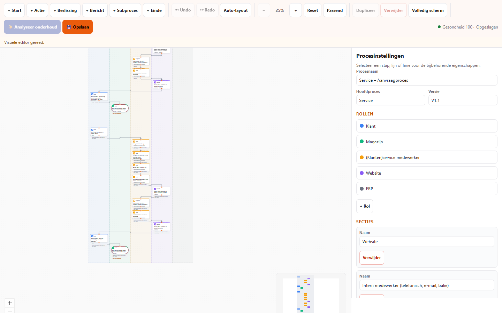
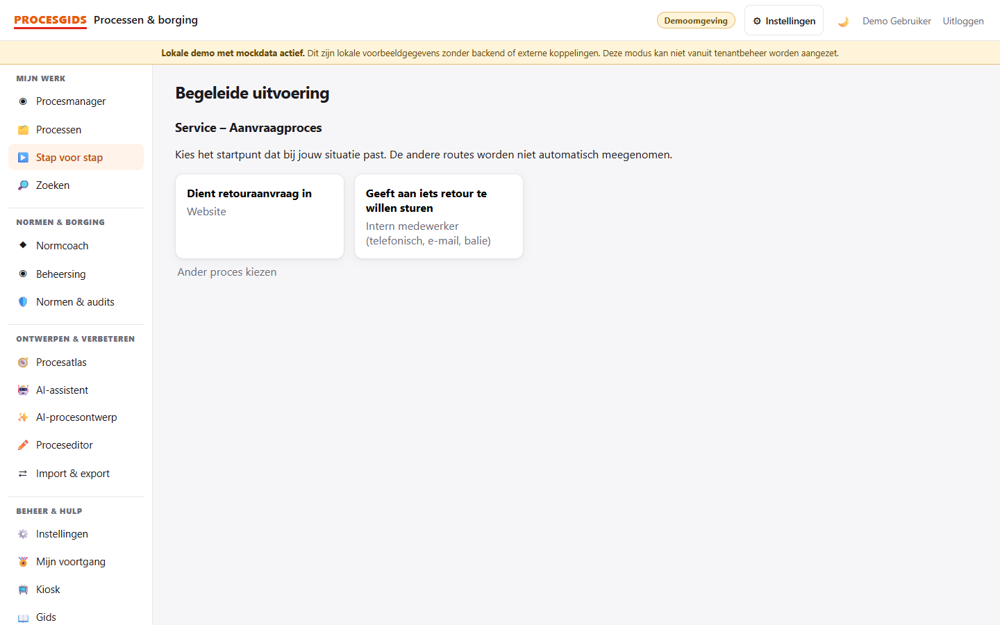

# Procesgids

**Van procesdiagram naar een werkinstructie die medewerkers stap voor stap kunnen volgen.**

Procesgids is een webapplicatie voor organisaties die hun werkprocessen centraal willen vastleggen, publiceren en verbeteren. Medewerkers zien welke stap bij hun rol hoort. Procesbeheerders kunnen wijzigingen voorbereiden en laten beoordelen voordat ze zichtbaar worden op de werkvloer.



## Wat je ermee kunt

| Voor wie | Wat je kunt bekijken |
| --- | --- |
| Medewerkers | Open een proces als diagram of tabel. Volg een beslisroute in de begeleide modus en bekijk per stap wie verantwoordelijk is. |
| Procesbeheerders | Teken een proces met zwembanen, importeer een Visio-diagram en controleer de rollen en routes in de editor. Beheer concepten, reviews en versies. |
| Kwaliteitsmanagers | Koppel processtappen aan ISO-normen en gebruik de auditmatrix om vastlegging en opvolging voor te bereiden. |

Met een geconfigureerde AI-provider kun je ook een procesvoorstel uit tekst maken. De gebruiker controleert rollen en routes voordat het voorstel naar de editor gaat.

## Screenshots

De beelden komen uit de lokale demo. Klik op een screenshot om het op ware grootte te bekijken.

| Procesmanager | Procesatlas |
| --- | --- |
| [](docs/images/procesmanager.png) | [](docs/images/procesatlas.png) |
| Volg reviews, concepten en signalen op. | Bekijk waar processen op elkaar aansluiten. |

| Proceseditor | Stap voor stap |
| --- | --- |
| [](docs/images/proceseditor.png) | [](docs/images/stap-voor-stap.png) |
| Bewerk processtappen, rollen en routes. | Kies als medewerker de route die past bij je situatie. |

## Probeer de demo

Installeer [Node.js 24](https://nodejs.org/) en voer vanuit de repository uit:

```bash
cd frontend
npm ci
npm run dev:demo
```

Open het lokale adres dat Vite toont. Kies op het overzicht **Service – Aanvraagproces**, wissel tussen **Visualisatie** en **Tabel** en volg daarna een proces via **Stap voor stap**. Open **Procesatlas** om de samenhang tussen processen te bekijken. De demo draait met meegeleverde voorbeeldgegevens, zonder backend of account.

## Onder de motorkap

- **Frontend** met React, TypeScript, Vite, React Flow en Zustand.
- **Backend** met ASP.NET Core op .NET 10, EF Core en SQLite. De API controleert rollen voor bewerken, goedkeuren en publiceren.
- **Gedeeld contract** met OpenAPI, TypeScript-typen en voorbeeldgegevens.
- **Hosting** met Docker en afzonderlijke data en configuratie per organisatie.

Voor lokale ontwikkeling met de echte API en voor een eigen installatie staan de stappen in de [frontendhandleiding](frontend/README.md), [backendhandleiding](backend/README.md) en [hostinghandleiding](hosting/README.md).

Deze portfolio-uitgave gebruikt geanonimiseerde voorbeeldbestanden. De bron-pdf en bijbehorende visuele referenties zijn buiten deze uitgave gehouden. Tests die deze bestanden lezen, hebben de oorspronkelijke testbestanden nodig.

## Kennismaken

Wil je zien hoe Procesgids aansluit op de werkprocessen van jouw organisatie? Neem contact op via het [GitHub-profiel van Jaap Frank](https://github.com/jaapfrank) voor een demonstratie.
